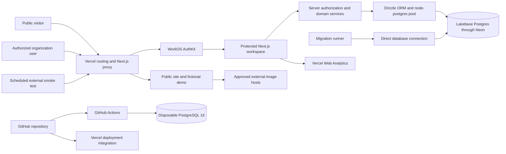
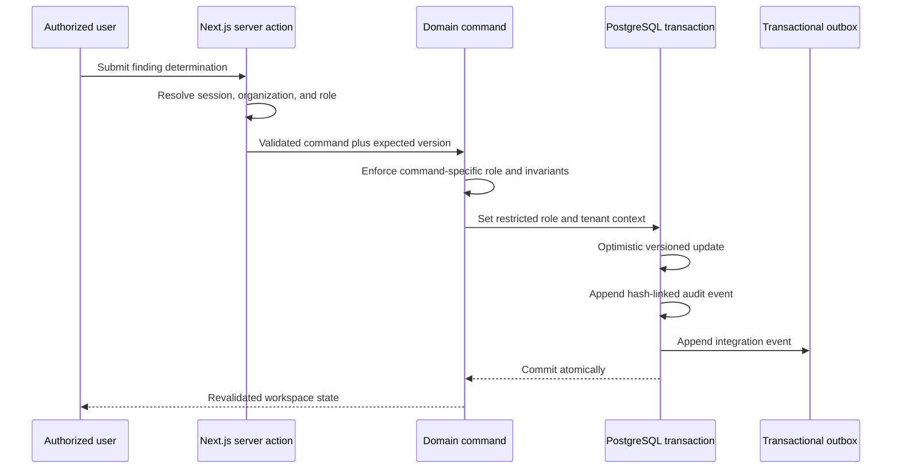

# Traceli solution architecture and security posture

Updated: 27 August 2026  
Status: current repository baseline; suitable for demonstrations and controlled non-production evaluation, not yet approved for real procurement documents or consequential live decisions

## Purpose and reading guide

This document gives product, engineering, enterprise architecture, and IT security reviewers one evidence-based view of Traceli's current solution, technology choices, trust boundaries, and remaining pilot gates.

Statements use three labels:

- **Implemented** means the control or component is present in this repository and can be tested from code.
- **Provider evidence required** means the application supports it, but the deployed Vercel, WorkOS, database, DNS, or GitHub setting must be confirmed in the relevant provider console before it is represented to a customer.
- **Planned** means it is an intended control, not a current capability.

The public demo uses fictional procurement data. No customer should upload or send live buyer, supplier, tender, bid, evaluation, personal, or commercially sensitive documents into the current product baseline.

The service spine that later code must follow is [eng/spine-p0-p1-p3.md](./eng/spine-p0-p1-p3.md), with the Field Registry v1 contract in [eng/field-registry-v1.md](./eng/field-registry-v1.md). Those documents name ownership and interfaces. They do not change the implemented controls in this baseline.

## Executive architecture decision

Traceli is a **modular monolith** through its first paid pilots:

- one Next.js application provides the public website, fictional demonstration, protected workspace, and backend-for-frontend;
- one PostgreSQL source of truth stores the tenant control graph, findings, decisions, and audit chronology;
- WorkOS supplies enterprise identity and organization context, while Traceli enforces domain authorization and tenant access;
- server-side domain services own consequential changes and create audit and outbox records in the same database transaction; and
- future document ingestion, model calls, background work, and external integrations must pass through the same authorization and domain-policy boundary.

This is deliberately simpler than a microservice estate. At pilot volume, it reduces distributed-system failure modes, makes transaction boundaries understandable, and allows a small team to test the whole security story. Components should split only when scale, isolation, or regulatory evidence creates a concrete need.

## Current system context

The diagram is the target runtime shape supported by the repository. Exact production project, region, network, backup, identity, and deployment settings are **provider evidence required**.

## Technology stack and rationale

Versions below are the installed repository versions on 27 August 2026.

| Layer | Current choice | Why it is used | Security and operations note |
| --- | --- | --- | --- |
| Web application | Next.js 16.3.3, React 19.2.4, TypeScript 5.7.3 | One typed application can serve the public story, protected UI, server rendering, server actions, and route handlers without creating a parallel API prematurely | Server-only modules protect database access. Next.js proxy performs route-level identity checks, but every protected operation must still authorize on the server |
| UI system | Tailwind CSS 4.3.3, Base UI 1.5.0, locally owned shadcn component utilities, Lucide | Fast, accessible, consistent interface composition with local ownership of application components | UI visibility is never treated as authorization |
| Hosting | Vercel | Natural operational fit for Next.js, preview deployments, managed TLS, and deployment integration | Production region, runtime version, WAF rules, log retention, access, and data-processing terms need provider evidence. The Node runtime is not yet pinned in `package.json`; CI currently uses Node 24 |
| Identity | WorkOS AuthKit for Next.js 4.3.1 and WorkOS Node 10.10.0 | Enterprise authentication, organization context, and a path to SSO and directory provisioning without building an identity provider | SSO, MFA, session policy, directory sync, organization provisioning, and production tenant separation need explicit configuration and evidence |
| Relational data | Lakebase Postgres through Neon | PostgreSQL transactions, constraints, row-level security, and an auditable relational model fit procurement control data | Application traffic uses a pooled URL; migrations use a direct URL. Region, TLS verification, recovery window, branching policy, IP controls, and private networking need evidence or configuration |
| Data access | Drizzle ORM 0.45.2, `pg` 8.23.0, Vercel Functions pool attachment | Typed schema access while retaining explicit SQL transactions, PostgreSQL roles, and row-level security | Tenant operations set the organization context transaction-locally. This must continue to be tested through the deployed pooler, not only against CI PostgreSQL |
| Validation | Zod 4.4.3 plus command-specific validation | Reject malformed or out-of-policy writes at the server boundary | Validation is necessary but does not replace authorization, constraints, or threat-specific file controls |
| Analytics | Vercel Analytics 1.6.1 in production | Lightweight understanding of public product engagement | It is a runtime third party and must be covered by privacy notice, consent analysis where applicable, and subprocessor review |
| Product film | Remotion 4.0.517 | Reproducible product demonstration video from the application design system | Not part of the protected data path |
| Build and CI | pnpm 11.19.0, GitHub Actions, PostgreSQL 16 service | Reproducible dependency installation and automated type, build, migration, security, and tenant-isolation checks | Actions are pinned to immutable commits. Main-branch protection and CodeQL are not currently available/enabled on the repository plan |
| Runtime AI | None | The product can validate its trust boundary and customer problem before adding model cost and failure modes | Future models must sit behind a measured gateway with redaction, grounded inputs, structured outputs, human approval, audit records, evaluation, cost caps, and provider portability |

The model-routing and token-efficiency plan is maintained in [MODEL_ECONOMICS.md](./MODEL_ECONOMICS.md). The architecture assumes task-based routing: deterministic code first, smaller or open models where quality permits, premium models only where their measured uplift justifies cost, and no silent use of customer data for provider training.

## Application and deployment boundaries

### Public boundary

The landing page, documentation page, product film, health route, and fictional demo are public. They must never read from a customer tenant or imply that fictional evidence is live customer data.

The public landing page currently loads unoptimized affiliation images directly from approved external hosts. A visitor's browser may therefore contact those hosts. Self-hosting approved assets is preferable before formal privacy review. Vercel Analytics is also enabled in production.

### Protected workspace boundary

`/workspace` is fail-closed when WorkOS is configured:

1. Next.js proxy sends an anonymous user to WorkOS authorization.
2. The callback establishes the AuthKit session.
3. The server retrieves the authenticated user, WorkOS organization, and role.
4. Traceli rejects access without an organization or an allowed role.
5. The data layer begins a transaction, assumes the restricted database role, and sets `app.organization_id` with transaction-local scope.
6. Queries include an explicit organization filter, while PostgreSQL row-level security provides a second tenant boundary.

If WorkOS is not configured, protected navigation goes to the fictional demo with an unavailable state; it does not expose a database-backed anonymous workspace.

Current allowed workspace roles are `procurement-officer`, `panel-member`, `procurement-director`, `auditor`, and `workspace-admin`. Each domain command still applies its own narrower role policy. The first persisted finding-determination command permits only the officer and director roles.

### Write and audit boundary

The first persisted write slice follows this sequence:

Optimistic version checks prevent a stale screen from silently overwriting a newer determination. The domain state, audit event, and outbox event commit together.

No outbox dispatcher or external integration exists yet. The outbox is durable intent, not proof that an external system received an event.

## Data architecture

The current PostgreSQL control graph contains:

- organizations;
- procurements;
- source documents and source versions;
- requirements;
- findings;
- decisions;
- audit events; and
- outbox events.

Implemented database controls include:

- an organization identifier on tenant-owned records;
- composite foreign keys designed to prevent cross-organization relationships;
- row-level security enabled and forced on tenant tables;
- policies that compare each row's organization with transaction-local `app.organization_id`;
- a restricted `traceli_app` role with no login, superuser, or row-security bypass capability;
- an update/delete prevention trigger on audit events;
- hash-linked audit event sequence and previous-hash fields;
- migration checksums that fail if an applied migration file is changed; and
- automated two-tenant denial and append-only audit tests.

Important limitations:

- The audit chain is **tamper-evident under the restricted application role**, not tamper-proof against a privileged database administrator. It is not yet signed or externally anchored.
- Source versions have a lock field but do not yet have a database trigger that makes locked content immutable.
- The application role still has broad table-level update rights; domain commands and constraints provide the finer policy today.
- There is no private object store, upload route, quarantine area, malware scanner, extraction worker, controlled file download, retention engine, or legal-hold implementation.
- The health route proves that the web process responds; it does not test database or identity readiness.

## Environment model

| Environment | Current purpose | Data rule | Evidence status |
| --- | --- | --- | --- |
| Local development | Developer implementation and tests | Synthetic or fictional data only; secrets in ignored `.env.local` | Repository convention implemented |
| GitHub Actions | Automated type, build, migration, seed, and tenant-isolation validation | Disposable PostgreSQL 16 service and non-production test secrets | Workflow implemented |
| Vercel preview | Review deployment | Synthetic data only unless a separately isolated preview data policy is approved | Provider evidence required |
| Vercel production | Public website and fictional demonstration; protected workspace only when production identity and database configuration is deliberately provisioned | No real procurement documents under the current security gate | Provider evidence required |
| Future pilot | Named design-partner tenant | Only after the security acceptance gates below are closed | Planned |

Application traffic must use `DATABASE_URL` with the pooled endpoint. Migrations and administrative schema work must use `DATABASE_URL_UNPOOLED` with a direct connection. Transaction-scoped tenant context is compatible with a transaction pooler's lifecycle only if every tenant operation remains inside the same explicit transaction; this is a release invariant and requires an integration test against the actual deployed database path.

No database provider configuration is currently committed as infrastructure-as-code. A `.neon` directory, `neon.ts`, and `vercel.json` are absent, so region, recovery, network restrictions, and deployment settings cannot be inferred from the repository.

## Data classification and handling

| Classification | Examples | Current handling |
| --- | --- | --- |
| Public | Marketing copy, public product film, public docs | May be served publicly |
| Demonstration | Fictional tender, suppliers, scores, evidence, and decisions | May be used in the public demo; must be visibly identified as illustrative |
| Internal non-production | Synthetic tenant records, test configuration, development logs | Access-limited; no live customer content |
| Restricted customer | Tender documents, bids, evaluations, supplier evidence, commercial terms, decision records | **Not accepted by the current baseline** |
| Personal or special-category data | Names, contact details, signatures, declarations, identity, safeguarding or beneficiary data | **Not accepted unless a documented purpose, lawful basis, minimization rule, retention schedule, and approved controls exist** |
| Secrets | WorkOS credentials, database credentials, signing keys, provider tokens | Environment-secret storage only; never browser-exposed, committed, or logged |

Traceli should default to data minimization. It should not ingest beneficiary or special-category personal data merely because it appears in a procurement package. Pilot intake needs a documented exclusion and redaction process.

## Implemented security controls

| Control area | Implemented baseline | Repository evidence |
| --- | --- | --- |
| Identity gate | WorkOS AuthKit integration and protected-workspace redirect | [`proxy.ts`](../proxy.ts), [`app/auth/callback/route.ts`](../app/auth/callback/route.ts) |
| Tenant and role authorization | Server-derived organization and role allowlist; command-specific permissions | [`lib/workspace-access.ts`](../lib/workspace-access.ts), [`lib/domain/finding-commands.ts`](../lib/domain/finding-commands.ts) |
| Tenant data isolation | Explicit organization filters, restricted database role, transaction-local tenant context, forced RLS, composite tenant foreign keys | [`lib/dal/workspace.ts`](../lib/dal/workspace.ts), [`lib/db/tenant.ts`](../lib/db/tenant.ts), [`db/migrations/0001_tenant_safe_control_graph.sql`](../db/migrations/0001_tenant_safe_control_graph.sql), [`db/migrations/0002_restricted_application_role.sql`](../db/migrations/0002_restricted_application_role.sql) |
| Concurrency integrity | Expected-version compare-and-update | [`lib/domain/finding-commands.ts`](../lib/domain/finding-commands.ts) |
| Audit chronology | Append-only trigger, sequence, previous hash, stable SHA-256 event hash, audit and outbox in one transaction | [`lib/domain/audit-events.ts`](../lib/domain/audit-events.ts), [`db/migrations/0002_restricted_application_role.sql`](../db/migrations/0002_restricted_application_role.sql) |
| Schema integrity | Ordered migrations, SHA-256 checksums, separate direct migration connection | [`scripts/db/migrate.mjs`](../scripts/db/migrate.mjs) |
| Browser headers | HSTS, frame denial, MIME sniffing prevention, strict referrer policy, permissions policy, CSP, no powered-by header | [`next.config.mjs`](../next.config.mjs) |
| Secret/config validation | All-or-none WorkOS and database variables, URL and cookie checks, ignored local environment files | [`scripts/validate-env.mjs`](../scripts/validate-env.mjs), [`.env.example`](../.env.example), [`.gitignore`](../.gitignore) |
| Supply chain and CI | Locked dependencies; type, build, migration, tenant tests; secret scan; high-severity dependency audit; immutable action SHAs; weekly dependency updates | [`.github/workflows/ci.yml`](../.github/workflows/ci.yml), [`.github/dependabot.yml`](../.github/dependabot.yml) |
| External availability | Scheduled public route, health, media-range, and protected-redirect smoke checks | [`.github/workflows/production-smoke.yml`](../.github/workflows/production-smoke.yml), [`scripts/smoke-production.mjs`](../scripts/smoke-production.mjs) |
| Repository alerts | GitHub vulnerability alerts and automated security fixes | Provider evidence required for a customer evidence pack; current repository API reports both enabled |

The current content security policy is a useful baseline, not a strict CSP: production still permits inline scripts and inline styles. Nonces or hashes, third-party minimization, and report-only rollout should precede a strict policy claim.

## Threat model summary

| Threat | Current mitigation | Residual risk or next control |
| --- | --- | --- |
| Cross-tenant data access | Server organization context, explicit filters, composite tenant keys, forced RLS, restricted role, automated denial tests | Test every new query and command; add deployment-path pooler tests and periodic independent review |
| Privilege escalation or forged browser role | User, organization, and role are taken from the server session; domain command repeats authorization | Define production role lifecycle, least-privilege mapping, SCIM/deprovisioning, MFA/session requirements, and access-review evidence |
| Stale or conflicting decision update | Optimistic expected-version update | Extend the pattern to all consequential commands and expose safe conflict recovery to users |
| Audit deletion or rewriting | Append-only trigger for application role and hash-linked events | Add signed decision roots using managed keys and an independent anchor; restrict and monitor privileged database actions |
| Secret disclosure | Server-only data modules, environment validation, ignored local secret files, secret scanning | Document rotation, break-glass, least-privilege provider access, and log-redaction procedures |
| Malicious document, decompression bomb, or unsafe parser | File upload is not implemented | Add private quarantine, type/size/signature validation, antivirus scanning, sandboxed extraction, egress limits, and safe rendering before accepting files |
| Prompt injection or model data leakage | No runtime model path | Add input provenance, untrusted-content isolation, tool allowlists, structured output validation, redaction, model-provider controls, evaluation, and human confirmation before model use |
| Dependency or CI compromise | Lockfile, immutable action SHAs, secret scan, high-severity audit, Dependabot | Add CodeQL or equivalent SAST, protected main, signed releases/provenance as justified, and a remediation SLA |
| Denial of service or cost abuse | Managed hosting baseline and a small public surface | No application-specific rate limit or committed WAF policy; add endpoint budgets, rate limits, abuse monitoring, and spend alerts before opening costly routes |
| Insider or cloud administrator abuse | Restricted application role and audit history | Cloud/database admins remain privileged; require MFA, separation of duties, access logs, time-bound elevation, reviews, and customer-facing incident commitments |
| Third-party tracking or data disclosure | Narrow CSP allowlist and production-only analytics | Self-host public images, review analytics necessity and consent, maintain a subprocessor register, and constrain all future egress |

## What an IT security reviewer will ask

### Where is data hosted and which subprocessors receive it?

Vercel, WorkOS, GitHub, and the PostgreSQL provider are the current material technology providers; Vercel Analytics and external public image hosts also receive runtime requests in the public experience. Exact legal entities, regions, transfer mechanisms, retention, and subprocessors are **provider evidence required**. No customer-facing residency or sovereignty claim should be made from repository code alone.

### Is data encrypted?

The web application enforces production HTTPS upgrade and HSTS. Database URLs are server-side, but the deployment must prove certificate verification, ideally `sslmode=verify-full`, rather than merely assuming encryption from a connection string. Provider encryption at rest, key ownership, backup encryption, and rotation need contractual and console evidence. Customer-managed keys are not implemented.

### How are authentication, SSO, MFA, and provisioning handled?

WorkOS AuthKit is integrated. Production SSO connections, MFA enforcement, session lifetime, login risk controls, directory sync, just-in-time provisioning, deprovisioning, and break-glass access are configuration choices and need a pilot-specific policy. Traceli remains responsible for organization assignment, domain roles, procurement-resource assignment, and authorization.

### How is one customer isolated from another?

Isolation is layered: server session organization, explicit query filters, organization-scoped foreign keys, a restricted application role, forced PostgreSQL RLS, and automated two-tenant read/write denial tests. A test against the real pooled deployment path and an independent penetration test remain pre-live evidence gates.

### Can an administrator change the audit history?

The normal application role cannot update or delete audit events, and hashes expose changes to the sequence. A privileged database administrator can still alter database controls or recompute an unsigned chain. Until roots are signed and externally anchored, the accurate claim is **application-level tamper evidence**, not immutable or non-repudiable audit.

### What is the backup and disaster-recovery posture?

This repository does not define a production recovery point objective, recovery time objective, history window, region strategy, or restore runbook. PostgreSQL provider branching and restore capabilities can support recovery, but the selected plan and project configuration determine the actual window. A restore exercise using a sanitized environment is required before live data.

### How are vulnerabilities managed?

CI runs type/build checks, a secret scan, a high-severity package audit, database migrations, and tenant-isolation tests. Dependabot is enabled, and GitHub vulnerability alerts plus automated security fixes are enabled. The current private-repository plan does not provide the required main-branch protection endpoint and CodeQL is not enabled. Before a consequential pilot, use an appropriate plan or compensating control, add SAST, define severity-based remediation times, and commission application penetration testing.

### What is logged, and can it feed our SIEM?

Domain audit and transactional outbox records exist for the first persisted command. A normalized security/access log, authentication event ingest, administrative activity stream, protected-file access record, redaction policy, alerting rules, log retention, and SIEM export are not implemented. Logs must exclude secrets and minimize document/personal content.

### What are retention, deletion, legal hold, and tenant offboarding rules?

They are not implemented. Before customer files exist, define retention by record type, customer-configurable deletion where appropriate, legal-hold precedence, backup expiry behavior, verified tenant deletion, export, and contract termination handling.

### Does Traceli use customer data to train AI models?

There is no runtime AI integration today. Before one is introduced, model vendors, locations, retention, training opt-out, subprocessors, redaction, and evaluation must be approved. Each invocation should record purpose, model/provider, data classes, prompt/template version, input references, output hash, token/cost metrics, reviewer, and outcome. Open models are an option for suitable tasks, not an automatic security guarantee; hosting, weights, telemetry, patching, isolation, and license still require review.

### Does Traceli have certifications?

The repository does not establish SOC 2, ISO 27001, Cyber Essentials, GDPR compliance, HIPAA compliance, or any other certification. Do not make those claims. For an early pilot, provide a scoped security pack, architecture, data-flow record, subprocessor list, risk register, policies, test evidence, and clearly bounded data acceptance instead.

## Security acceptance gates

### Before accepting any real procurement document

1. Approve data classification, minimization, residency, retention, deletion, legal hold, and privacy terms with the design partner.
2. Provision isolated production WorkOS and database resources; capture region, encryption, backup/history, administrative access, MFA, session, and audit evidence.
3. Enforce verified database TLS, rotate to least-privilege credentials, and decide whether IP allowlisting or private networking is required and compatible with Vercel egress.
4. Implement a private object-storage boundary with quarantine, file signature/type/size validation, malware scanning, sandboxed parsing, encrypted versioned storage, controlled short-lived downloads, access logs, and deletion/hold processing.
5. Make locked source versions immutable at the database boundary and narrow table grants as more domain commands are introduced.
6. Add structured access, security, and administrative logging with redaction, alerting, retention, and an export path.
7. Define recovery objectives and complete a witnessed restore exercise.
8. Add rate limiting, WAF/abuse rules, error monitoring, spend alerts, and readiness checks for dependencies.
9. Complete a threat-model review, privacy review, dependency/SAST baseline, and independent penetration test with critical and high findings closed.

### Before a consequential live award decision

1. Move every approval, exception, lock, and export through tested server-side commands with optimistic concurrency and transactional audit.
2. Sign sealed decision roots with a managed key and preserve verification evidence outside the mutable application database.
3. Add customer-approved role provisioning, resource assignment, access review, deprovisioning, and break-glass procedures.
4. Establish incident response, on-call ownership, customer notification commitments, vulnerability SLAs, change approval, and rollback practice.
5. Protect the release branch and require reviewed, passing changes; add CodeQL or a comparable SAST control.
6. Establish service objectives, dependency monitoring, operational dashboards, and a tested continuity runbook.
7. Execute the DPA, security schedule, subprocessor register, and a narrowly scoped pilot statement of work.

## Provider evidence checklist

The customer security pack should record an owner, capture date, reviewer, and evidence link for each item:

- Vercel project, deployment region/runtime, domains/TLS, WAF and rate-limit configuration, access roles/MFA, environment-secret access, logs, retention, analytics, and DPA/subprocessors;
- WorkOS production environment, organization and role model, SSO/MFA/session policy, directory provisioning/deprovisioning, audit events, administrative access, and DPA/subprocessors;
- database project and region, pooled/direct URLs, certificate verification, encryption, protected branches, backup/history window, restore evidence, IP/private-network choice, access roles/MFA, logs, credential rotation, and DPA/subprocessors;
- GitHub organization/repository access, MFA, vulnerability alerts, automated fixes, branch controls or compensating approval evidence, CI logs, secret scanning, dependency review, SAST, and incident contacts;
- DNS registrar and domain access, MFA, transfer lock, certificate management, and recovery contacts; and
- every analytics, email, file-storage, monitoring, model, integration, or support provider added later.

## Architecture decision rationale

| Decision | Rationale | Revisit when |
| --- | --- | --- |
| Modular monolith | Preserves one authorization and transaction boundary; minimizes pilot operational complexity | A measured workload, isolation requirement, team boundary, or regulated processing need justifies separation |
| PostgreSQL as canonical state | Strong relational constraints, transactions, RLS, mature recovery, and understandable audit joins | Large immutable blobs move to object storage; derived search/index state may use a rebuildable specialist store |
| WorkOS for identity, Traceli for authorization | Avoids building enterprise authentication while retaining control over procurement-specific permissions | A buyer mandates another identity broker; integrate through standards without moving domain policy to the browser |
| Pooled app connection and direct migrations | Fits serverless concurrency while preserving migration/session semantics | Runtime platform or workload changes; keep tenant context transaction-scoped |
| Hash-linked transactional audit | Makes domain chronology testable and couples it atomically to state changes | Add managed signatures and external anchoring for sealed decisions |
| No runtime model yet | Avoids cost, privacy, prompt-injection, and trust complexity before the customer problem and data spine are validated | A design partner identifies a bounded, measurable assistive task with human review |
| Provider-portable model gateway later | Enables task/quality/cost routing, including open models, without binding core evidence to one vendor | Measurements show specialization or hosting constraints justify a dedicated path |
| Documents deferred | A secure file boundary is materially more work than a form upload and must exist before sensitive data | The complete quarantine-to-deletion control set and customer terms are approved |

## Repository evidence map

- Application boundary and headers: [`next.config.mjs`](../next.config.mjs), [`proxy.ts`](../proxy.ts)
- Identity and workspace access: [`lib/workspace-access.ts`](../lib/workspace-access.ts), [`lib/workspace-viewer.ts`](../lib/workspace-viewer.ts)
- Protected UI and write boundary: [`app/workspace/page.tsx`](../app/workspace/page.tsx), [`app/workspace/actions.ts`](../app/workspace/actions.ts)
- Database connection and tenant transaction: [`lib/db/client.ts`](../lib/db/client.ts), [`lib/db/tenant.ts`](../lib/db/tenant.ts)
- Data access and domain commands: [`lib/dal/workspace.ts`](../lib/dal/workspace.ts), [`lib/domain/finding-commands.ts`](../lib/domain/finding-commands.ts)
- Audit construction: [`lib/domain/audit-events.ts`](../lib/domain/audit-events.ts)
- Schema and tenant controls: [`db/schema.ts`](../db/schema.ts), [`db/migrations/0001_tenant_safe_control_graph.sql`](../db/migrations/0001_tenant_safe_control_graph.sql), [`db/migrations/0002_restricted_application_role.sql`](../db/migrations/0002_restricted_application_role.sql)
- Migration, seed, and isolation proof: [`scripts/db/migrate.mjs`](../scripts/db/migrate.mjs), [`scripts/db/seed.mjs`](../scripts/db/seed.mjs), [`scripts/db/test-tenant-isolation.mjs`](../scripts/db/test-tenant-isolation.mjs)
- Configuration and CI: [`scripts/validate-env.mjs`](../scripts/validate-env.mjs), [`.github/workflows/ci.yml`](../.github/workflows/ci.yml), [`.github/workflows/production-smoke.yml`](../.github/workflows/production-smoke.yml)
- Product roadmap and operating model: [ARCHITECTURE_ROADMAP.md](./ARCHITECTURE_ROADMAP.md), [AUTONOMOUS_OPERATIONS.md](./AUTONOMOUS_OPERATIONS.md), [MODEL_ECONOMICS.md](./MODEL_ECONOMICS.md)

## Provider references

These explain capabilities, not Traceli's selected-plan configuration:

- [Neon connection pooling](https://neon.com/docs/connect/connection-pooling)
- [Neon IP Allow](https://neon.com/docs/introduction/ip-allow)
- [Neon branching](https://neon.com/docs/introduction/branching)
- [Neon instant restore](https://neon.com/docs/introduction/branch-restore)

Provider documentation and console evidence must be rechecked at each customer review because plans, defaults, and product names can change.
