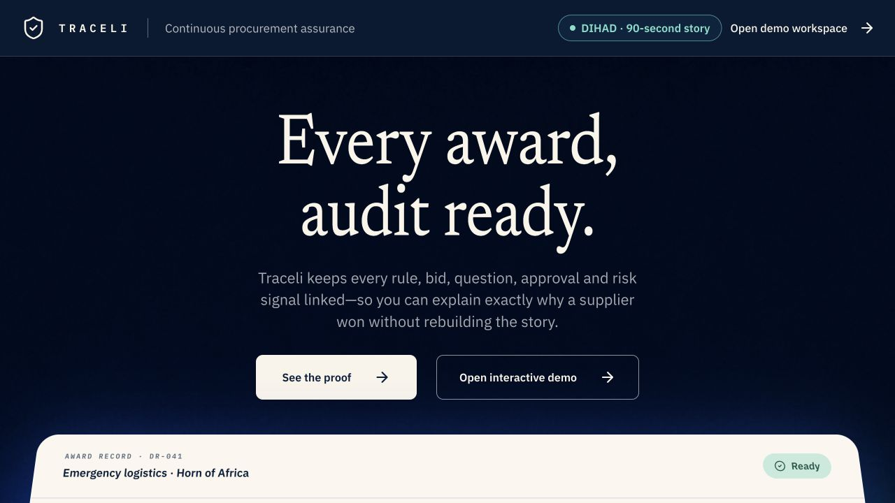

# Traceli landing reference audit — 25 August 2026

## Audit scope

The public Traceli landing page, compared with the current [WorkOS homepage](https://workos.com/) and Vanta's [automated compliance](https://www.vanta.com/products/automated-compliance) and [on-demand demo](https://www.vanta.com/downloads/on-demand-demo) patterns. This is a UX and trust review for the ten-second hook and ninety-second DIHAD conversation.

## User goal

A procurement officer should understand `the proof behind the award`, see a realistic tender move through the system, and choose either the walkthrough or a retrospective pilot without needing an explanation.

## Strengths

- `Every award, audit ready.` is memorable and category-level.
- The current source-linked award answer is strong product proof and should be reused, not discarded.
- The public demo is correctly separated from the protected workspace.

## Notable risks

- The centered hero, two similarly weighted actions, large proof card, and lifecycle explanation compete before the visitor has chosen a path.
- A bare `Built by` logo strip could be mistaken for customers, partnerships, or endorsement. This is especially sensitive for UN and INGO marks.
- Public MCP documentation would reduce trust if the interface is not available or if it implies unrestricted document access.
- A staged tender import that looks live would undermine the assurance positioning if viewers later learn it was only animation.

## Comparison context

- WorkOS starts with a left-aligned promise and actions, then progressively reveals product building blocks and developer documentation. Its feature modules are concrete but do not compete with the hero.
- Vanta's current public pattern makes the category promise first, places customer proof immediately after it, and uses dedicated product/demo surfaces to show the platform rather than explaining every workflow in the hero.
- The useful pattern is hierarchy and progressive proof, not visual imitation.

## Recommendations

1. Recompose the hero as a left-aligned promise with a restrained walkthrough surface on the right.
2. Remove `See the proof`; make the 90-second walkthrough the dominant action and the interactive workspace secondary.
3. Use three outcome modules: `Draft from your rules`, `Run the evaluation`, and `Defend the award`.
4. Add `Built by people with experience at` only after affiliation and mark-use verification. Do not describe the organizations as customers or endorsers.
5. Record a deterministic tender-to-proof walkthrough from a public completed or buyer-approved sanitized tender. Label it illustrative until every shown action works in product.
6. Add workflow and security docs now; label MCP and integrations by availability and publish setup instructions only when the corresponding interface passes its security gate.

General health: the promise and visual identity are strong; the conversion hierarchy needs one focused simplification pass before more product surface is added.
