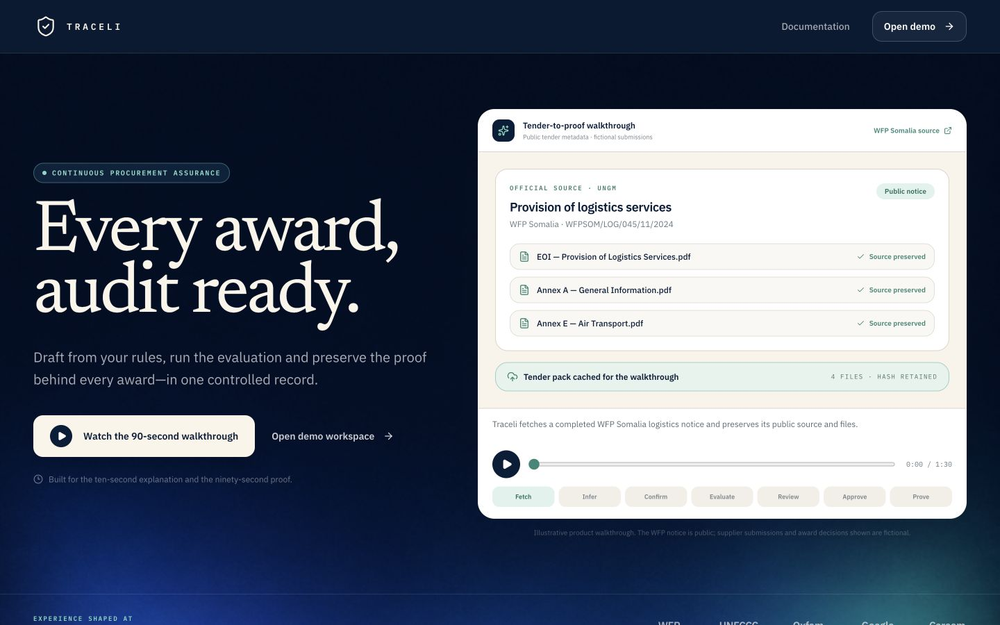
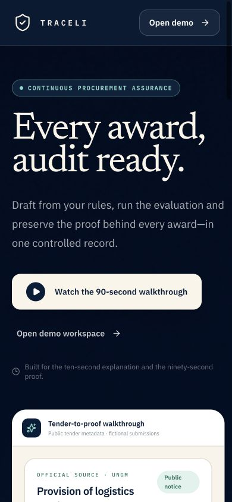
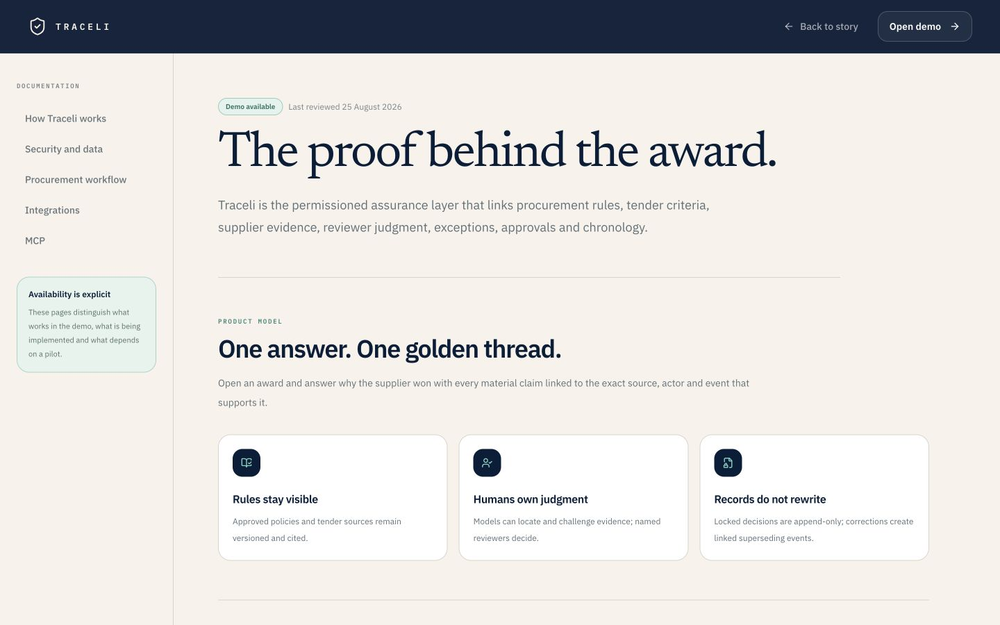

# Sprint 0.5 landing QA — 25 August 2026

## Scope

Public landing page, deterministic tender walkthrough, public documentation route, responsive behavior and the existing demo route reached from the new calls to action.

## Visual evidence

## Confirmed

- The desktop first screen presents one left-led promise, one dominant walkthrough action and one secondary demo path.
- The walkthrough identifies the public WFP Somalia UNGM notice and labels its supplier and award content fictional.
- The organization strip is phrased as prior experience and explicitly disclaims endorsement; official marks are not used pending clearance.
- Three outcome modules route to the existing demo instead of presenting inert controls.
- `/`, `/docs` and `/demo` load without a framework error overlay.
- Desktop and 390 px mobile layouts have no horizontal overflow.
- The documentation page labels capabilities as demo available, in implementation, private alpha planned or pilot dependent.
- TypeScript and the Next.js production build pass.

## Evidence limit

The in-app visual test surface rendered the player and its controls correctly but did not expose client-state changes after automated button activation. The playback state machine is type-checked and visually present; confirm its timed transitions once in the user-visible preview before deployment.

## Result

Implementation complete; interview validation, playback confirmation in the visible preview, and organization-mark clearance remain before production promotion.
